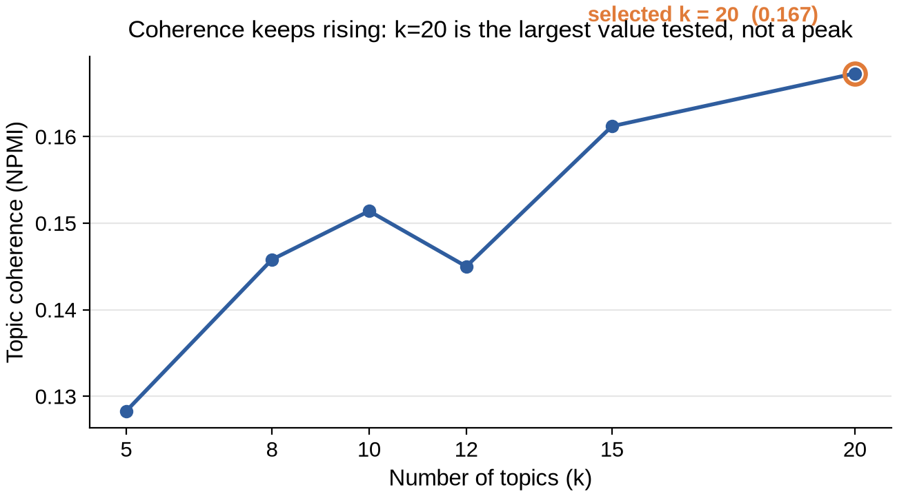
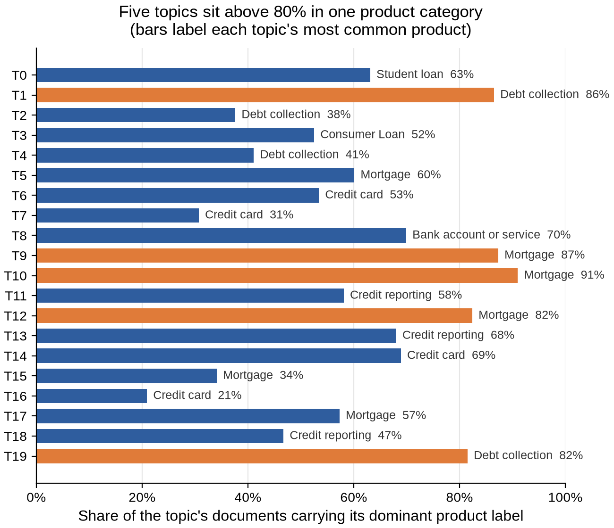
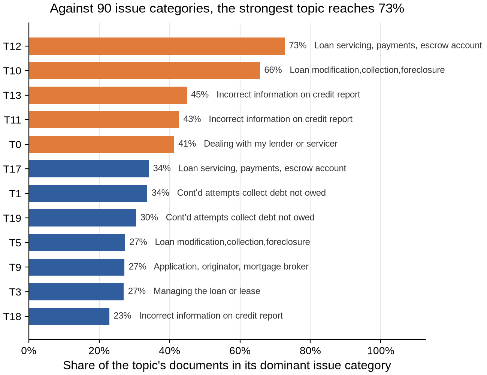

# Task 1 — NLP Topic Analysis of Consumer Complaint Texts

**Project: Data Analysis (CSEBDSEDA02)**

Extracts the topics consumers most frequently complain about, from a corpus of
free-text complaints filed with the U.S. Consumer Financial Protection Bureau.

---

## Contents

1. [Summary](#1-summary)
2. [Results](#2-results)
3. [Figures](#3-figures)
4. [Repository layout](#4-repository-layout)
5. [Getting started](#5-getting-started)
6. [The data](#6-the-data)
7. [How it works](#7-how-it-works)
8. [Configuration](#8-configuration)
9. [Design decisions](#9-design-decisions)
10. [Known limitations](#10-known-limitations)
11. [Reproducing the results](#11-reproducing-the-results)
12. [Licence and attribution](#12-licence-and-attribution)

---

## 1. Summary

A corpus of complaints is cleaned and reduced to a set of topics, without any
human labels being used to guide the process. Twenty topics are extracted with
two independent methods and then checked against the two label columns the
corpus happens to carry — labels neither method ever saw.

The interesting part is not that topics emerged, since topic models will always
produce topics. It is that the topics line up with the human categorisation, and
that this can be measured.

| | |
|---|---|
| Documents analysed | **111,108** |
| Topics extracted | **20** |
| Methods compared | LDA and NMF |
| Representations compared | TF-IDF and sentence embeddings |
| Strongest validation | 72.7 % of one topic's documents fall in a single human issue category |

---

## 2. Results

Run on 111,108 documents:

| Measure | Value | Reading |
|---|---|---|
| Selected topic count | 20 | Chosen by coherence sweep — see the caveat in §10 |
| Best coherence (NPMI) | 0.1673 | Moderate; acceptable for real complaint text |
| LDA / NMF agreement | 0.172 | Low — see §10 |
| Vectorisation agreement | 0.053 | The two representations mostly disagree about similarity |
| Topics above 80 % product concentration | 5 of 20 | Strong evidence of recovered structure |
| Topics below 15 % issue concentration | 7 of 20 | Diffuse; general service themes, not distinct concerns |

**The headline result.** Each topic's documents were cross-tabulated against the
human `Product` and `Issue` labels. Topic 10 is 91 % Mortgage. Topic 9 is 87 %
Mortgage. Topic 1 is 86.5 % Debt collection. Against the finer 90-category
`Issue` field, topic 12 reaches 72.7 % on *"Loan servicing, payments, escrow
account"* and topic 10 reaches 65.7 % on *"Loan modification, collection,
foreclosure"*. Unsupervised topic modelling recovered a segmentation that human
categorisers applied independently.

Every figure quoted in the written report is written to
`outputs/results_summary.json` — that file is the single source of truth.

---

## 3. Figures

The three figures below are generated from `outputs/results_summary.json` by
`figures.py`. They are not drawn by hand and contain no estimated values.

### Coherence by number of topics



Coherence rises with the topic count and never turns over. This is why 20 is
reported as a lower bound rather than a discovered optimum (see §10).

### Topic concentration against product labels



Each bar shows the share of a topic's documents carrying its most common product
label. Five topics exceed 80 %, with three near 90 %. The short bars at the
bottom are the diffuse topics, shown deliberately rather than hidden.

### Topic concentration against issue labels



The harder test — 90 categories instead of 11. The strongest topic still reaches
73 %. Values fall off as the category space grows, which is the expected
behaviour and not a failure.

To regenerate the figures:

```bash
python figures.py
```

---

## 4. Repository layout

```
.
├── README.md                    this file
├── requirements.txt             pinned dependencies
├── .gitignore
│
├── pipeline.py                  stage 1 — clean and deduplicate
├── vectorise.py                 stage 2 — TF-IDF and embeddings
├── topics.py                    stage 3 — coherence sweep, LDA, NMF, validation
├── figures.py                   stage 4 — draws the three figures above
│
├── figures/                     output PNGs (committed)
├── data/                        the corpus goes here (NOT committed)
└── outputs/                     artefacts and results_summary.json
```

The corpus is deliberately excluded. See §6 for where to get it.

---

## 5. Getting started

### Requirements

- Python 3.10–3.12 (3.13+ may lack prebuilt wheels for some dependencies)
- About 3 GB of free RAM for the full corpus
- Around 40 minutes for a complete run

### Install

```bash
python -m venv .venv
source .venv/bin/activate          # Windows: .venv\Scripts\activate

pip install -r requirements.txt
python -m spacy download en_core_web_sm
```

### Run

```bash
mkdir -p data
# put Consumer_Complaints.csv in data/ — see §6

python pipeline.py
python vectorise.py
python topics.py
python figures.py
```

Each stage writes its output to disk, so a later stage can be re-run without
repeating the ones before it. If `topics.py` needs a change, you do not pay for
the 25-minute embedding step again.

### Smoke test first

```bash
python vectorise.py --sample 5000
```

Runs the whole chain on 5,000 documents in about a minute. Use this to check a
change before committing to the full corpus.

---

## 6. The data

The corpus is **not included in this repository** — it is 255 MB, and it is
third-party data.

Download `Consumer_Complaints.csv` from Kaggle:

<https://www.kaggle.com/datasets/ashwinik/consumer-complaints-financial-products>

Place it at `data/Consumer_Complaints.csv`. If you keep it elsewhere, set an
environment variable rather than editing code:

```bash
DATA_DIR=/path/to/folder python pipeline.py
```

### Why the corpus is much smaller than the file

| Stage | Rows |
|---|---|
| Source file | 670,598 |
| Rows carrying a published narrative | 114,704 |
| After removing exact duplicates | 112,690 |
| After dropping documents under 10 words | **111,108** |

Only 17 % of the source file contains complaint text at all. A complaint is
published only if the complainant consents, so roughly **83 % of the file is
empty of text**. That is a structural property of the source, not a cleaning
artefact, and it is reported as a finding in the write-up rather than presented
as routine filtering.

---

## 7. How it works

Four stages, run in order.

| Stage | Script | What it does | Runtime |
|---|---|---|---|
| 1 | `pipeline.py` | Drops empty rows, deduplicates, cleans text, writes a parquet | 2–3 min |
| 2 | `vectorise.py` | Builds a TF-IDF matrix and sentence embeddings | ~25 min |
| 3 | `topics.py` | Sweeps the topic count, fits LDA and NMF, validates against labels | ~10 min |
| 4 | `figures.py` | Draws the figures from `results_summary.json` | seconds |

**Stage 1 — cleaning.** Lowercases, strips URLs, removes the `XXXX` redaction
placeholders the source uses for personal data, removes punctuation, and filters
documents shorter than ten words.

**Stage 2 — representation.** Two views of the same corpus are built in
parallel: a sparse TF-IDF matrix (5,000 features) and dense sentence embeddings
(384 dimensions). A neighbourhood-overlap score measures how far the two agree
about which documents are similar to which.

**Stage 3 — topics.** LDA is re-fitted across a range of candidate topic counts
and coherence is measured at each, so the count is selected from evidence rather
than assumed. LDA and NMF are then fitted at the selected count, and their topic
vocabularies compared. Finally each topic's documents are cross-tabulated against
the `Product` and `Issue` labels, which no model has seen.

**Stage 4 — figures.** Draws the three plots in §3 straight from the results
file.

---

## 8. Configuration

Each script has a `CONFIG` block at the top. The settings that most affect
results:

| Setting | Default | Why it matters |
|---|---|---|
| `MIN_WORDS` | 10 | Corpus median is 137 words, so this removes a negligible tail |
| `TFIDF_MAX_DF` | 0.5 | Terms in >50 % of documents are boilerplate, not topics |
| `TOPIC_CANDIDATES` | 5–20 | The range swept for the topic count |
| `EMBEDDING_MODEL` | `all-MiniLM-L6-v2` | 384-dim, fast enough on CPU for 111 k documents |
| `SEED` | 42 | Fixed everywhere, so repeated runs are identical |

---

## 9. Design decisions

**The topic count is selected, not assumed.** LDA is re-fitted across a range of
candidate values and the best-coherence one wins. The full sweep is saved so the
choice can be audited — and, as §10 explains, so the weakness of the choice is
visible.

**Two models chosen to disagree usefully.** LDA and NMF share bag-of-words
assumptions but decompose differently. Their agreement is measured as a Jaccard
overlap of topic vocabularies.

**Coherence is implemented directly.** Normalised point-wise mutual information,
about fifteen lines, rather than a library call. An unnormalised co-occurrence
count scores a pair of very common words highly merely for being common, which
saturates the metric and leaves the sweep unable to tell topic counts apart. The
implementation depends on no library that might not build.

**External validation against human labels.** The corpus carries `Product`
(11 classes) and `Issue` (90 classes) labels no model has seen. A topic
concentrating in one human-applied label is evidence the model recovered real
structure — and this turned out to be the strongest result in the analysis.

**Collocation merging guards against double merges.** Frequent bigrams become
single tokens (`credit_report`), but a candidate is rejected when the whole
bigram already exists as one token. Without that guard, a second merge pass
produces tokens like `wells_fargo home_mortgage` that never appeared in the
source text.

---

## 10. Known limitations

Stated plainly, because a reader should not have to discover these.

**Twenty topics is a lower bound, not an optimum.** The coherence curve rises
monotonically to the largest value tested and never turns over. The honest
reading is that the best topic count is at least twenty, and possibly higher.
The figure in §3 shows this directly.

**Model agreement is low at 0.172.** LDA and NMF agree on only about a sixth of
their topic vocabulary, and the figure covers 13 matched pairs out of 20 — seven
topics found no counterpart in the other model.

**Seven topics are diffuse.** Concentrations below 15 % against their dominant
issue category mean those topics describe broad service themes rather than
distinct concerns. The short bars in the product figure are those topics.

**The corpus is a self-selected subset.** Only complaints where the complainant
consented to publication appear, which is 17 % of the source file. Any topic
distribution here describes that subset, not all complaints filed.

**The vocabulary is capped at 5,000 features.** A larger vocabulary would change
the topics at the margins.

---

## 11. Reproducing the results

Everything is seeded, so a rerun on the same data produces the same numbers.

```bash
python pipeline.py && python vectorise.py && python topics.py && python figures.py
```

Then compare `outputs/results_summary.json` against the figures quoted in §2.

**Environment note.** The published run was executed on a hosted Linux notebook
rather than locally, because the local machine's application-control policy
blocks Python packages containing compiled extensions. Any Linux or macOS
environment meeting the requirements in §5 will work identically. This is
recorded because it affects how the code was executed, not what it computes.

---

## 12. Licence and attribution

Code written for coursework (CSEBDSEDA02).

The complaint data is published by the U.S. Consumer Financial Protection Bureau
and carries its own terms of use. Check them before redistributing the corpus.
